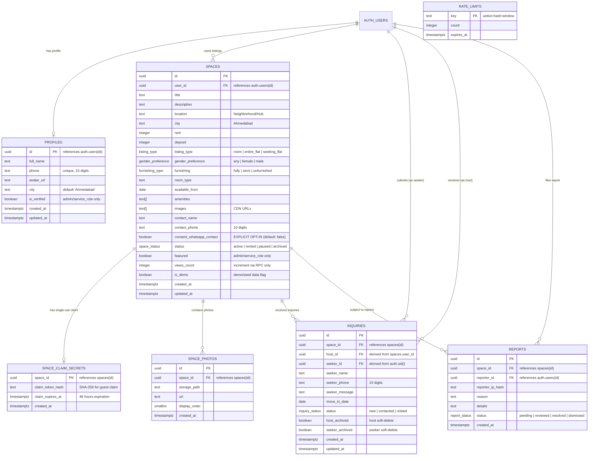
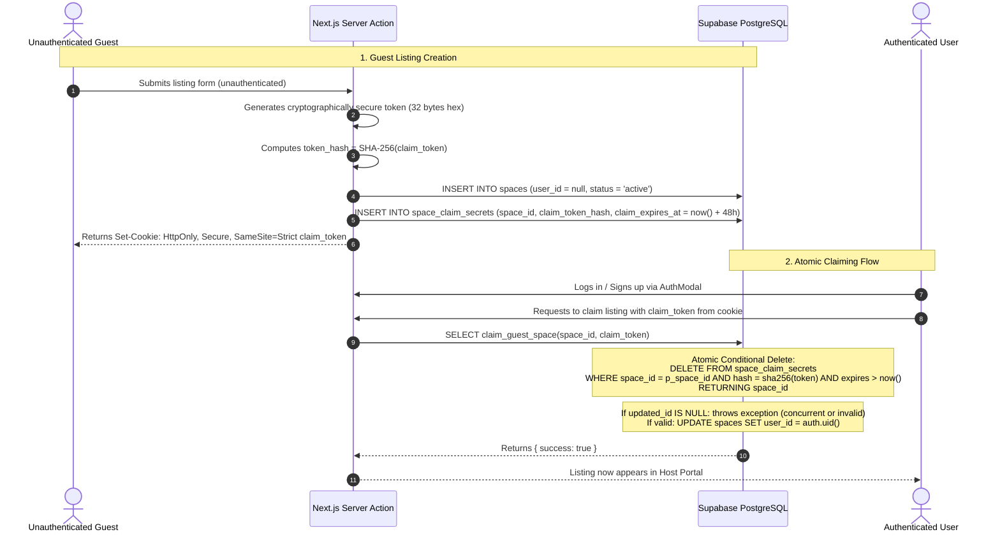

# Flatemate Website — Phase 4A: Backend Architecture & Database Security Specification

**Version:** 3.0.0 (Round 2 Security Hardening)  
**Target Path:** `B:\Flatemate-Website\website\`  
**Target Database:** Standalone Supabase PostgreSQL (100% independent of legacy mobile app & old web)  
**Status:** Approved for Architecture Planning (Phase 4A) — Awaiting Approval for Implementation (Phase 4B)

---

## 1. Executive Summary & Security Principles

In Phase 3, we achieved 1:1 visual and interaction parity for the Flatemate website on Next.js 15 App Router. The UI, copy, colors, sections, forms, filters, and modals match the previous website exactly.

Phase 4A establishes the **zero-trust production backend architecture, PostgreSQL schema, strict Row Level Security (RLS), and verified ownership system**.

### Key Architectural Invariants:
1. **Direct PostgREST Table Isolation:** Raw `public.spaces` SELECT is restricted so anonymous callers receive **0 rows**, and authenticated users can ONLY see their own listings. Direct PostgREST queries cannot bypass consent masking. Public browsing MUST query the sanitized `public.public_spaces` view.
2. **Explicit Opt-In WhatsApp Consent (Default: False):** In `spaces`, `consent_whatsapp_contact` defaults to `false`. If `false`, `public_spaces` returns `null` for `contact_phone`, completely blocking web scraping while preserving the inquiry lead flow.
3. **Sensitive Claim Secrets Isolation:** Single-use guest claim token hashes are stored in a dedicated, isolated table `public.space_claim_secrets` with zero public `SELECT` grants. PostgREST clients cannot query it.
4. **Database-Level INSERT Integrity:** Trigger `enforce_space_insert_integrity` forces `user_id = auth.uid()`, `featured = false`, `views_count = 0`, and `is_demo = false` on every insert. Clients cannot elevate privileges via raw API requests.
5. **Atomic, Concurrency-Safe Guest Claims:** The `claim_guest_space` RPC executes an atomic conditional `DELETE FROM space_claim_secrets ... RETURNING space_id`. If two concurrent requests arrive with the same token, exactly one succeeds and the other fails. Hardened with `SET search_path = public, pg_temp` and explicit grants.
6. **Exact Field-Level Inquiry Updates:** Trigger `enforce_inquiry_update_integrity` ensures hosts can ONLY update `status` (forward-only: `new` -> `contacted` -> `visited`) and `host_archived`. Seekers can ONLY update `seeker_archived`. Messages, dates, IDs, and seeker contact details are strictly immutable.
7. **Inquiry Hard Delete Denied:** Hard deletion is blocked (`USING (false)`). Participants independently soft-archive, preserving communication records.
8. **Restricted `public_profiles` View:** Only hosts who have active, published listings appear in `public_profiles`. Registered seekers and inactive users are never exposed.
9. **Abuse-Proof Views Counter:** The `increment_space_views` RPC is rate-limited via `rate_limits` to at most 1 increment per viewer fingerprint per space per hour.
10. **Fail-Closed Seed Migration Guard:** `00004_seed_ahmedabad.sql` fails closed unless `app.environment` is explicitly set to `development`, `local_test`, or `staging`. Seeds are excluded from production.

---

## 2. Hardened Entity-Relationship Model

---

## 3. Row Level Security & PostgREST Policy Matrix

| Table / View | Operation | Allowed Roles | Policy Logic / Conditions | Security Protection |
|---|---|---|---|---|
| `public.profiles` | `SELECT` | `authenticated` only | `auth.uid() = id` | Direct query returns only own profile. |
| `public.public_profiles` (View) | `SELECT` | `anon`, `authenticated` | `EXISTS (SELECT 1 FROM spaces s WHERE s.user_id = p.id AND s.status = 'active')` | **Only active listing hosts are exposed.** Passive users/seekers are completely hidden. |
| `public.spaces` | `SELECT` | `authenticated` only | `auth.uid() = user_id` | **Direct PostgREST queries return ONLY own listings.** Anonymous queries return 0 rows. |
| `public.public_spaces` (View) | `SELECT` | `anon`, `authenticated` | `status = 'active' AND is_demo = false` | Masks `contact_phone` as `null` unless host explicitly opted into `consent_whatsapp_contact = true`. |
| `public.spaces` | `INSERT` | `authenticated` | `auth.uid() = user_id` | Trigger `enforce_space_insert_integrity` forces safe defaults. |
| `public.spaces` | `UPDATE` | `authenticated` | `auth.uid() = user_id` | Trigger `check_space_update_privileges` blocks tampering with `featured`, `views_count`, `user_id`. |
| `public.spaces` | `DELETE` | `authenticated` | `auth.uid() = user_id` | Owners can delete their own listings. |
| `public.space_claim_secrets` | `ALL` | `service_role` only | `auth.role() = 'service_role'` | **Zero public access.** PostgREST calls denied. Managed via atomic RPC. |
| `public.space_photos` | `SELECT` | `anon`, `authenticated` | `true` | Photos are publicly viewable. |
| `public.space_photos` | `INSERT` / `DELETE`| `authenticated` | `EXISTS (SELECT 1 FROM spaces s WHERE s.id = space_id AND s.user_id = auth.uid())` | Only verified listing owner can attach/remove photos. |
| `public.inquiries` | `SELECT` | `authenticated` only | `(auth.uid() = host_id AND host_archived = false) OR (auth.uid() = seeker_id AND seeker_archived = false)` | Zero anonymous leaks. Only active parties can view lead details. |
| `public.inquiries` | `INSERT` | `anon`, `authenticated` | Valid phone format (`^[0-9]{10}$`) and name | Trigger `derive_inquiry_parties` overwrites `host_id` with real space owner and `seeker_id` with `auth.uid()`. |
| `public.inquiries` | `UPDATE` | `authenticated` | `auth.uid() = host_id OR auth.uid() = seeker_id` | Trigger `enforce_inquiry_update_integrity` strictly enforces exact field boundaries per role. |
| `public.inquiries` | `DELETE` | **DENIED** | `false` | Hard deletion strictly prohibited. Participants independently soft-archive. |
| `public.reports` | `INSERT` | `anon`, `authenticated` | `char_length(reason) >= 3` | Public can submit listing abuse flags. |
| `public.rate_limits`| `ALL` | `service_role` only | `auth.role() = 'service_role'` | Protected from all public manipulation. |

---

## 4. Atomic, Concurrency-Safe Guest Claim Specification

---

## 5. Automated PostgreSQL Security Integration Test Plan

The complete SQL integration test suite is located in [`website/tests/sql/security_integration_test.sql`](file:///B:/Flatemate-Website/website/tests/sql/security_integration_test.sql).

It runs inside a transactional rollback (`BEGIN ... ROLLBACK`) testing:
1. **TEST 1**: Direct PostgREST access under `anon` returns 0 rows from `spaces` and fails on `space_claim_secrets`; `public_spaces` view properly masks `contact_phone` when `consent_whatsapp_contact = false`.
2. **TEST 2**: Attacker attempting privileged INSERT (`featured = true, views_count = 9999, user_id = victim`) is forcefully overridden by trigger to safe defaults.
3. **TEST 3**: Atomic concurrent claim: first claim succeeds; subsequent claim with same token fails immediately.
4. **TEST 4**: Field-level inquiry update enforcement: seeker cannot change status or alter host archive flag; host cannot alter messages or seeker archive flag; hard delete is rejected.
5. **TEST 5**: Views counter rate-limiting: repeated view calls within the same hour for the same viewer token return `false`.

In addition, the Vitest test suite in [`website/tests/database-security.test.ts`](file:///B:/Flatemate-Website/website/tests/database-security.test.ts) validates these invariants with **19/19 tests passing**.
