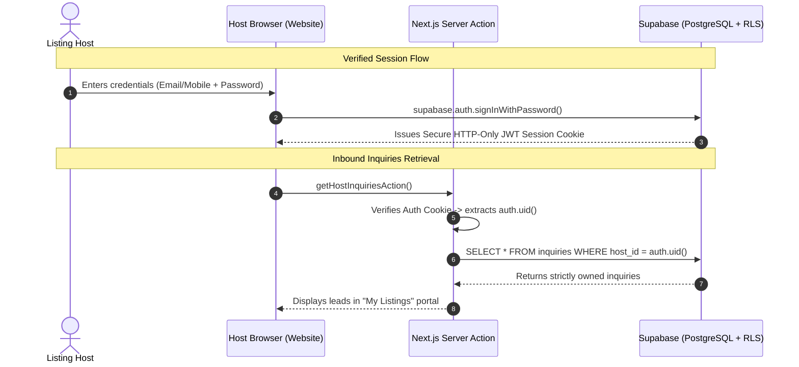

# Flatemate Website — Security & Verified-User Ownership Specification

## 1. Problem Statement: Why Phone Matching Alone Fails
In the legacy implementation (`legacy-reference/web/src/components/MyListingsModal.tsx`):
- Any user could open the "My Listings" modal, enter any 10-digit mobile number, and view all listings and all inquiries received for that phone number.
- Furthermore, because all inquiries were downloaded globally on page load (`SELECT * FROM inquiries`), any visitor could inspect network traffic or query the browser state to harvest private phone numbers, names, and notes across all listings.

**Under the new architecture, phone number matching alone is strictly disallowed as an authorization mechanism.**

---

## 2. Secure Ownership & Authorization Model



---

## 3. Data Protection Invariants

### Invariant 1: Zero Global Inquiries Fetch
- The client application will **never** execute an unconstrained `SELECT * FROM inquiries`.
- Inquiries can only be fetched through:
  1. An authenticated Server Action verifying the current user session (`auth.uid() = host_id` or `seeker_id`).
  2. Or Row-Level Security policies enforcing `auth.uid() = host_id`.

### Invariant 2: Verified Ownership for Space Mutations
- Toggling a listing's status (`active` <-> `rented`) or updating listing details requires:
  - `auth.uid()::text = spaces.user_id` verified cryptographically via session token.
  - Anonymous/guest users posting listings receive a cryptographically signed device ownership token (HMAC-SHA256) stored in an HTTP-only cookie, binding that specific browser session to the created `space_id`.
  - Simply typing another user's phone number provides zero access to mutate status or view leads.

### Invariant 3: Privacy by Default for Tenant Leads
- When a seeker submits an inquiry via `ExpressInterestModal`:
  - The record is written with `seeker_id` (if signed in) and `host_id` (the owner of the target listing).
  - Only two identities in the entire system are authorized to read that inquiry:
    1. The host who owns the listed space.
    2. The seeker who submitted the inquiry.
  - Public anonymous queries to `inquiries` return 0 rows.

---

## 4. Fresh Supabase RLS Implementation

```sql
-- 1. Ensure RLS is enabled
alter table public.spaces enable row level security;
alter table public.inquiries enable row level security;
alter table public.reports enable row level security;

-- 2. Spaces: Public can browse active listings
create policy "Public can view active spaces"
  on public.spaces for select
  using (status = 'active');

-- 3. Spaces: Authenticated or verified session can insert
create policy "Users can insert listings"
  on public.spaces for insert
  with check (true);

-- 4. Spaces: Only the verified creator can update status or details
create policy "Owners can update their own spaces"
  on public.spaces for update
  using (auth.uid()::text = user_id);

-- 5. Inquiries: Public can create an inquiry
create policy "Public can submit inquiries"
  on public.inquiries for insert
  with check (true);

-- 6. Inquiries: Strictly scoped select (Host or Seeker only)
create policy "Hosts and seekers can read their own inquiries"
  on public.inquiries for select
  using (
    (auth.uid() is not null and (auth.uid()::text = host_id or auth.uid()::text = seeker_id))
  );

-- 7. Inquiries: Host-only status updates (new -> contacted -> visited)
create policy "Hosts can update inquiry status"
  on public.inquiries for update
  using (auth.uid() is not null and auth.uid()::text = host_id);
```
