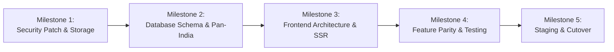

# Flatemate — Phase 1: Phased Implementation Roadmap

**Audit Date:** 2026-10-31  
**Execution Standard:** Zero-downtime, branch-isolated, strict approval gates

---

## Roadmap Milestones Overview

---

## Milestone 1: Immediate Security Patch & Storage Migration
- **Goal**: Protect user PII, secure RLS, eliminate Base64 image payload bloat.
- **Dependencies**: Backup of current Supabase database.
- **Scope**:
  1. Export snapshot of current Supabase `spaces` and `inquiries` tables.
  2. Create Supabase Storage bucket `listing-photos` with public read and authenticated write access.
  3. Deploy updated RLS SQL policies restricting `inquiries` SELECT and `spaces` UPDATE to authorized users.
  4. Update `web/src/lib/supabase.ts` and `web/src/App.tsx` to upload photos directly to storage and remove `getCloudInquiries()` global query on page load.
- **Complexity**: Low-Medium (1–2 days).
- **Acceptance Criteria**:
  - Unauthenticated visitors can no longer fetch all rows from `inquiries`.
  - Property photo uploads produce a public CDN URL instead of a Base64 string.
  - Existing listings continue to render properly.
- **Approval Gate 1**: Owner verifies security patches on staging/production without breaking live listings.

---

## Milestone 2: Normalized Schema for Pan-India Expansion
- **Goal**: Expand database model beyond Ahmedabad to support major Indian metropolitan areas.
- **Dependencies**: Milestone 1 complete.
- **Scope**:
  1. Add `city`, `locality`, and `state` columns to `spaces` table with appropriate indexes.
  2. Populate supported metro cities (Ahmedabad, Bengaluru, Pune, Mumbai, Delhi NCR, Hyderabad) and their popular localities.
  3. Create migration script ensuring all existing Ahmedabad listings are correctly mapped with `city = 'Ahmedabad'`.
- **Complexity**: Low (1 day).
- **Acceptance Criteria**:
  - SQL schema supports querying listings filtered by `city` and `locality`.
  - Zero data loss for existing listings.
- **Approval Gate 2**: Owner reviews and confirms city taxonomy.

---

## Milestone 3: Next.js Foundation & Dynamic SEO Routing
- **Goal**: Establish modern, server-rendered web application with dynamic routing for organic discovery.
- **Dependencies**: Dedicated git branch (`feature/nextjs-modernization`).
- **Scope**:
  1. Initialize Next.js (App Router) with TypeScript strict mode and Tailwind CSS.
  2. Port design tokens, colors, and typography from current frontend.
  3. Implement route structure:
     - `/` — Pan-India discovery hub & city selector.
     - `/[city]` — City-specific marketplace (e.g. `/ahmedabad`, `/bengaluru`).
     - `/[city]/flats` & `/[city]/roommates` — Filtered feeds with URL search params.
     - `/listing/[id]` — Server-rendered listing detail page with dynamic OpenGraph tags for WhatsApp sharing.
  4. Implement modular components using accessible primitives (shadcn/ui / Tailwind).
- **Complexity**: Medium-High (4–6 days).
- **Acceptance Criteria**:
  - Listing pages return full HTML on initial request with complete JSON-LD and OpenGraph tags.
  - Sharing any listing link on WhatsApp renders title, price, locality, and preview image.
- **Approval Gate 3**: Owner previews staging build on Netlify preview branch.

---

## Milestone 4: Feature Parity & Trust Enhancements
- **Goal**: Replicate all working features from current app and implement high-priority trust features.
- **Dependencies**: Milestone 3 complete.
- **Scope**:
  1. Post Listing workflow with multi-step wizard and Supabase Storage integration.
  2. Host Portal (`My Listings`) with authenticated lead management.
  3. Express Interest & Visit Booking modals.
  4. Implement Trust & Verification Shield badge (from `marketing_strategy.md`).
  5. Automated end-to-end smoke tests (Playwright) covering search, filter, post, and inquiry journeys.
- **Complexity**: Medium (3–4 days).
- **Acceptance Criteria**:
  - 100% feature parity with current live site.
  - Automated test suite passes with zero regressions.
- **Approval Gate 4**: Owner reviews end-to-end verification report.

---

## Milestone 5: Domain Cutover & Post-Launch Observation
- **Goal**: Seamless production switchover to custom domain (Hostinger or existing) with zero downtime.
- **Dependencies**: Milestones 1–4 approved.
- **Scope**:
  1. Configure custom domain DNS records (A/CNAME) pointing to production deployment.
  2. Configure SSL/TLS certificates and canonical 301 redirects from legacy URL.
  3. Validate Supabase Auth redirect URLs and CORS settings.
  4. Keep legacy Netlify deployment operational as an immediate fallback.
  5. Post-launch monitoring of error rates, search console indexation, and inquiries.
- **Complexity**: Low (1 day).
- **Acceptance Criteria**:
  - Custom domain resolves securely via HTTPS.
  - Zero downtime during DNS propagation.
- **Approval Gate 5**: Final owner sign-off.
